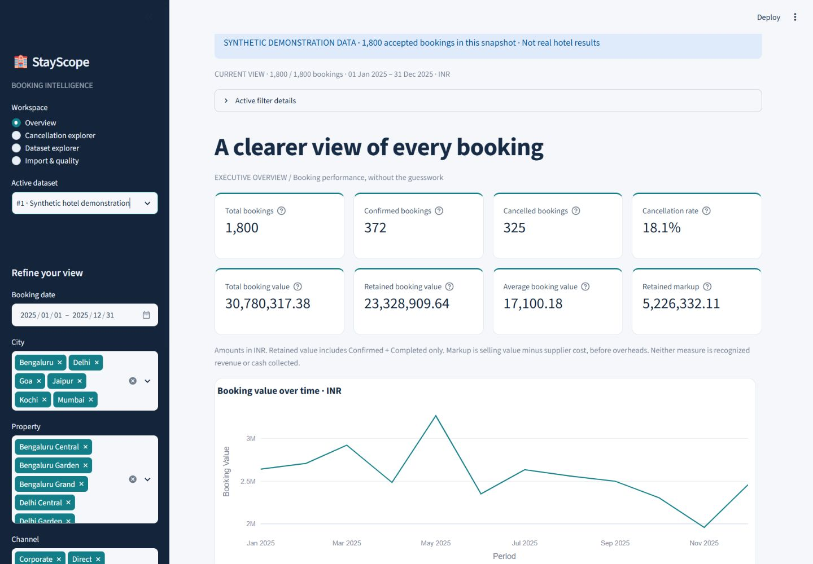
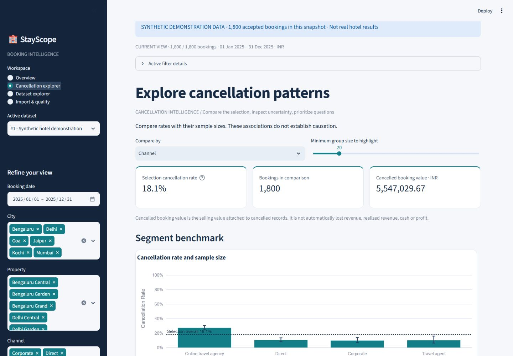
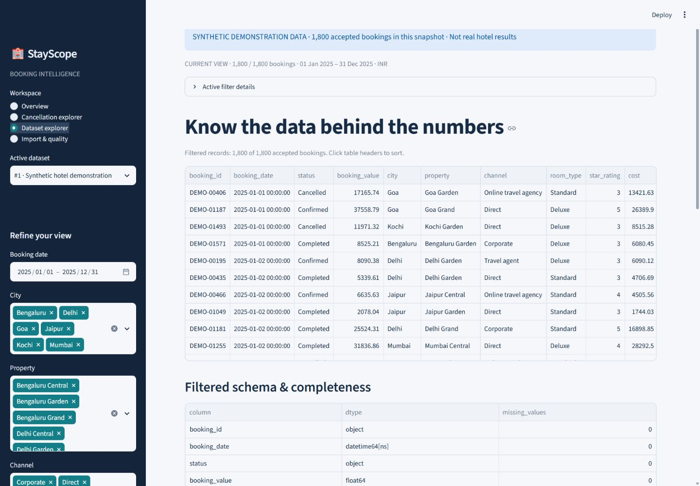
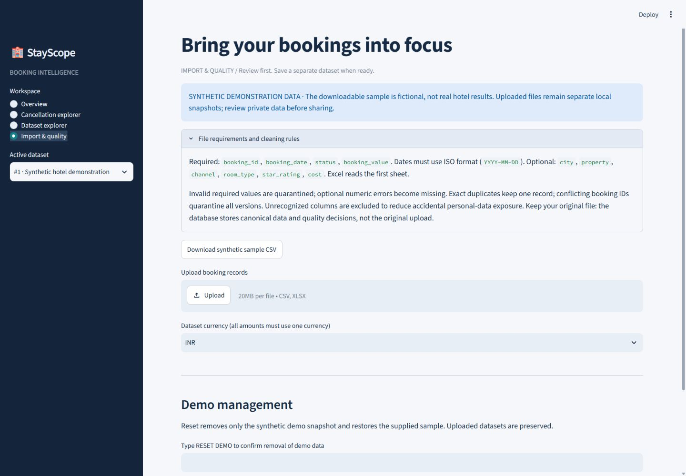
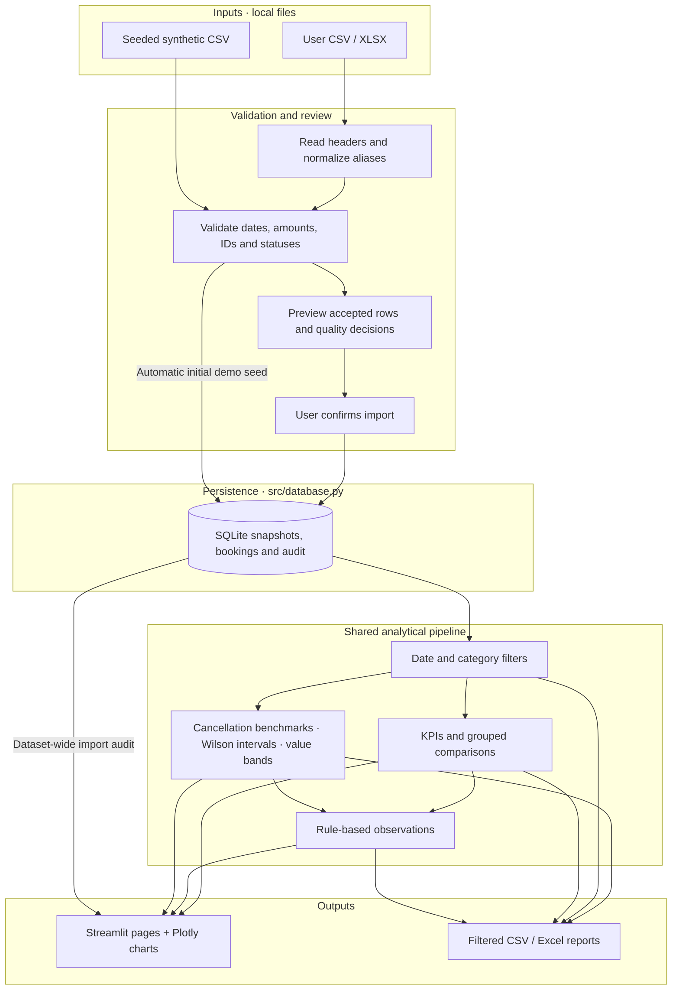

# StayScope Booking Intelligence

A local Python analytics application for investigating hotel booking value, cancellation patterns and data quality. It turns CSV/XLSX files into validated SQLite snapshots, interactive dashboards and reproducible reports.

**Version 2.0 · Portfolio project · Synthetic demonstration data · Not deployed**



Hotel managers and analysts need consistent booking totals and defensible comparisons before making operational decisions. StayScope makes validation decisions visible and uses the same filtered records for KPIs, charts and exports. These are intended users, not claimed customers.

Explore the [synthetic-data case study](docs/PORTFOLIO_CASE_STUDY.md), [résumé and interview notes](docs/RESUME_PROJECT_ENTRY.md), and [verification record](TEST_RESULTS.md).


## Key features

- **Data engineering:** CSV/XLSX ingestion, explicit validation, row-level quarantine and repeat-import protection.
- **Business analysis:** documented KPI formulas, cancellation denominators, sample-size cautions and transparent rule-based observations.
- **Application development:** four Streamlit pages, interactive Plotly charts and shared date/property/channel/room/status/rating filters.
- **Persistence and reliability:** transactional SQLite snapshots, guarded demo reset, modular Python and automated UI/data tests.
- **Reporting:** filtered booking CSV, KPI/finding CSV and five-sheet Excel reports with filter context and cancellation benchmarks.

## Product tour

| Page | Manager's question | Working features |
|---|---|---|
| Overview | How is the booking portfolio performing? | Eight KPI cards, value trends, channel/room/rating/status charts, property tables and insights |
| Cancellation explorer | Which groups have different cancellation rates? | Channel, room, city, property, rating and month benchmarks; Wilson intervals, cancelled booking value and quantile bands |
| Dataset explorer | Can I trust and inspect these numbers? | Filtered records, missing counts, data types, statistics and original import audit |
| Import & quality | What will happen to my uploaded records? | Quality preview, quarantined records, explicit approval, separate saved snapshots |

**Demo provenance:** the included CSV contains 1,800 fictional bookings for six Indian cities across 2025, generated with NumPy seed 42. Amounts are INR. The app visibly labels the demo; these are not real hotel results or claimed client outcomes.

## Technology stack

| Layer | Technology |
|---|---|
| Language | Python 3.12 verified; Python 3.11 within declared dependency requirements |
| Analysis | Pandas, NumPy |
| Interface | Streamlit |
| Visualization | Plotly |
| Persistence | SQLite via Python's standard library |
| Excel | openpyxl |
| Tests | Pytest, Streamlit AppTest |

No paid APIs, external accounts or application environment variables are required. No `.env.example` is needed.

## Dashboard screenshots

Genuine captures from the local application, 24 October 2026. All data shown is fictional. Each PNG is under 155 KB; the Overview capture appears above.

**Cancellation explorer:** selected population, cancellation rates and uncertainty.



**Dataset explorer:** accepted demo records and schema completeness.



**Import & quality:** empty intake form and validation rules; this image does not depict a completed upload.



To refresh screenshots, run the app, select the synthetic snapshot and keep its provenance notice visible. Use Win+Shift+S on Windows or your OS screenshot tool. Save reviewed captures in `docs/screenshots/` with the existing descriptive names; never use private uploads or alter displayed figures. A separate invalid-row preview can be captured without saving that upload. Never reset the database to obtain a screenshot.


## Analytical methods and KPI definitions

| KPI | Definition |
|---|---|
| Total bookings | Accepted rows in the current selection |
| Confirmed / Cancelled bookings | Rows with the corresponding exact status |
| Cancellation rate | Cancelled / all selected bookings; unavailable when empty |
| Total booking value | Sum of selling value across all selected statuses |
| Retained booking value | Selling value for Confirmed + Completed |
| Average booking value | Total value / total bookings; unavailable when empty |
| Retained markup | Sum(value − supplier cost) for Confirmed + Completed; unavailable if any eligible cost is missing |

All five statuses enter the cancellation denominator. Selecting only Cancelled therefore gives 100%. Confirmed and Cancelled cards alone do not reconcile to total bookings: Completed, Pending and No-show also count. Booking value and markup are not cash collected, recognized revenue or accounting profit.


## Advanced cancellation analytics

Cancellation explorer compares **channel, room type, city, property, star rating and booking month** within the current sidebar selection. Its threshold flags small groups without hiding them or changing denominators. Findings use the requested threshold consistently, even when the reusable insight function receives a table built with a different threshold. Active-filter details and the selected row count remain visible above the analytical pages.

| Measure | Definition |
|---|---|
| Segment cancellation rate | Cancelled rows / all rows in that segment |
| Overall benchmark | Cancelled rows / all currently filtered rows, including the compared segment |
| Difference in percentage points | 100 × (segment rate − overall rate) |
| Cancelled booking value | Sum of booking values for Cancelled records; not automatically lost revenue, cash or profit |
| 95% Wilson interval | Descriptive binomial interval for the segment's cancellation proportion |
| Value bands | Up to four quantile bands recomputed from the current selection; ties remain together |

The comparison chart shows Wilson error bars and the overall benchmark. A second chart shows cancelled booking value in the selected dataset's currency. Detailed segment and value-band tables share currency-labelled monetary columns, rate/interval labels and sample cautions. Chart tooltips format rates as percentages and amounts to two decimal places. Value-band analysis includes its own chart, table and observations. Findings state denominators and suggest questions to investigate, without promising business impact or identifying causes.

**Interpretation and safeguards:** all five canonical statuses enter the denominator. Missing categories become `Unknown`; invalid or absent statuses produce a clear validation error. Invalid monetary values do not affect count denominators; a cancelled-value total is unavailable if any contributing value is invalid. Findings explicitly report how many cancelled values are unavailable, and never present a partial total as a complete share. Invalid values form an explicit `Unavailable value` band when the reusable functions are called directly. Normal imports quarantine these invalid monetary rows before analysis. Empty data preserves the output schema and produces a friendly UI state. Inputs are copied, never mutated.

Quantile boundaries are right-closed, with the first lower boundary included. Ties can produce fewer or unequal-sized bands; all equal values produce one band. The displayed boundaries are rounded labels. Bands are relative to the selection and should not be compared as fixed price tiers across different filters.

Wilson intervals assume independent binomial observations. They do not correct for hotel/customer clustering, selection bias or multiple comparisons, and interval overlap or separation alone is not a test of differences or evidence of causation. See the [NIST statistical handbook](https://www.itl.nist.gov/div898/handbook/prc/section2/prc241.htm) for the method. A synthetic demonstration is not a representative sample of real hotel activity.

CSV exports retain their established scope. Excel preserves `Summary` and `Filtered bookings` and adds:

| Worksheet | Contents |
|---|---|
| Cancellation benchmarks | All six dimensions, sample sizes, cancelled counts/value, rates, Wilson bounds, percentage-point differences and small-sample flags |
| Value bands | Quantile comparisons for the same filtered selection |
| Report guide | Metric definitions, currency, threshold, provenance and interpretation caveats |

Monetary columns carry a `currency` field. The cancellation page exports its selected minimum sample size; other pages default to 20. Missing optional categories become `Unknown`; unavailable values are explicitly labelled. Empty selections retain worksheet headers and a guide. Dimension totals repeat the same bookings: **never sum across dimensions**. Export text receives spreadsheet-formula protection.

## Business questions to investigate

- Which channels have higher observed cancellation rates, and how many bookings support each comparison?
- Does the pattern persist within comparable booking months, cities, properties and room types?
- Where is the largest selling value associated with cancellations?
- How do cancellation patterns vary across booking-value bands?
- Which missing values or conflicting records limit confidence in a report?

The [case study](docs/PORTFOLIO_CASE_STUDY.md) provides reproducible observations and follow-up questions, without attributing causes or claiming savings.


## Architecture



The automatic seed path applies only to the bundled demo; uploaded data requires review. Each upload is a separate snapshot, so overlapping files are never silently combined. Parameterized SQL and transactions protect imports; demo restoration validates the replacement before an atomic delete/restore operation.

## Folder structure

```text
booking-analytics/
├── app.py                       # Streamlit entry point and four pages
├── src/
│   ├── __init__.py
│   ├── analytics.py             # Filters, KPIs, comparisons and insights
│   ├── advanced_analytics.py    # Cancellation benchmarks, Wilson intervals and quantiles
│   ├── charts.py                # Consistent Plotly presentation
│   ├── database.py              # SQLite persistence and safe reset
│   ├── exports.py               # CSV/XLSX reports and formula protection
│   ├── sample.py                # Reproducible synthetic generator
│   └── validation.py            # Schema, aliases and quality decisions
├── data/
│   └── sample_hotel_bookings.csv # Only data file intended for Git
├── scripts/
│   ├── audit_metrics.py         # Read-only Decimal reconciliation
│   ├── generate_sample.py       # Generates sample only if absent
│   └── init_db.py               # Idempotent setup
├── tests/                       # Unit, integration and AppTest checks
├── docs/
│   ├── DATA_GUIDE.md            # Schema, cleaning and metric assumptions
│   ├── PORTFOLIO_CASE_STUDY.md   # Reproducible synthetic analysis
│   ├── RESUME_PROJECT_ENTRY.md   # Résumé bullets and interview notes
│   ├── screenshots/             # Genuine synthetic-only captures
│   └── RELEASE_CHECKLIST.md     # Review, next commit and publishing steps
├── .streamlit/config.toml       # Public theme and upload settings
├── .github/workflows/tests.yml  # Push/PR CI definition; remote execution pending
├── .gitignore
├── requirements.txt            # Bounded direct dependencies
├── requirements-tested.txt     # Verified direct versions, not a full lockfile
├── pytest.ini
├── README.md
├── AUDIT_REPORT.md
├── TEST_RESULTS.md
├── IMPLEMENTATION_PLAN.md
└── LICENSE
```

`data/bookings.db`, uploaded/private data, virtual environments and caches are local artifacts excluded from Git. Genuine captures of all four pages are included under `docs/screenshots/`, using only the synthetic snapshot or empty import form.

## Installation and local execution

Use Python 3.12. Windows Python 3.12.14 has been verified; other machines and operating systems remain unverified. Run commands from the project root containing `app.py`. No API keys or application environment variables are needed.

### Windows PowerShell

```powershell
py -3.12 -m venv .venv
.\.venv\Scripts\Activate.ps1
python -m pip install -r requirements.txt
python -m pip check
python -m streamlit run app.py --server.address 127.0.0.1
```

If activation is blocked, use `.\.venv\Scripts\python.exe` in place of `python`; no execution-policy change is necessary. Do not recreate an environment you need to preserve.

### General Python environment (POSIX shell)

```sh
python3.12 -m venv .venv
. .venv/bin/activate
python -m pip install -r requirements.txt
python -m pip check
python -m streamlit run app.py --server.address 127.0.0.1
```

These are standard POSIX setup commands, not a claim of a fresh Linux/macOS install test. Open `http://127.0.0.1:8501`; stop with Ctrl+C. If occupied, add `--server.port 8502`. The app seeds the demo when no datasets exist. Optional explicit initialization: `python scripts/init_db.py`. Never delete a database to refresh application code.

`requirements.txt` bounds direct dependencies; `requirements-tested.txt` records tested direct versions and is not a complete transitive lockfile. Dependencies have not been upgraded for this documentation work.

## Testing

With the environment activated:

```sh
python -m pytest -q -ra
python scripts/audit_metrics.py
```

The latest completed verification recorded **164 passed, 0 failed, 0 skipped, 0 pytest warnings**. See [TEST_RESULTS.md](TEST_RESULTS.md) for dated runs and exact commands. Tests cover all four pages, filters, malformed imports, persistence, calculations and CSV/Excel exports using disposable databases. The metric audit reads the live database without modifying it.

The existing [CI workflow](.github/workflows/tests.yml) installs dependencies and runs tests and demo reconciliation on Windows/Ubuntu with Python 3.12 for pushes, pull requests and manual dispatch. It uses read-only permissions and no project secrets. **Remote execution of the current uncommitted changes is pending.** No passing CI badge or cross-platform certification is claimed.


## Import data and generate reports

1. Start with the synthetic snapshot and explore Overview.
2. Select dates and categories in the sidebar; all analytical pages and reports use this selection. An empty multiselect means no matching records.
3. Open Cancellation explorer and compare rates alongside denominators.
4. Upload CSV/XLSX through Import & quality, review decisions, confirm the currency, and save. Select the saved snapshot in the sidebar.
5. Download the selected bookings or summary report. Table search, sort and Plotly zoom are presentation controls and do not redefine sidebar filters.

Required columns: `booking_id`, `booking_date`, `status`, `booking_value`. Dates must be ISO-formatted. Optional fields add city, property, channel, room type, rating and supplier cost. See the [data guide](docs/DATA_GUIDE.md) for aliases, validation rules and all formulas.

**Interpretation:** Total booking value includes every selected status. Retained booking value includes Confirmed + Completed. Retained markup subtracts supplier cost only when eligible costs are complete. These are not cash collected, recognized revenue or accounting profit. All five statuses reconcile to the total: 372 Confirmed + 998 Completed + 325 Cancelled + 62 Pending + 43 No-show = 1,800 in the bundled demo. Cancellation rate is 325 / 1,800 = 18.0556%, displayed as 18.1%.

## Data dictionary and accepted schema

One row represents one booking, not a payment or room-night. The included `data/sample_hotel_bookings.csv` has 1,800 fictional records across six Indian cities in 2025, generated with seed 42; all amounts are INR.

| Column | Required | Meaning and validation |
|---|---|---|
| booking_id | Yes | Nonempty identifier, unique within a snapshot |
| booking_date | Yes | ISO date; ISO timestamps normalize to UTC day |
| status | Yes | Confirmed, Completed, Cancelled, Pending or No-show |
| booking_value | Yes | Finite nonnegative selling value per booking |
| city, property, channel, room_type | No | Categories; missing values become Unknown |
| star_rating | No | Integer 1–5; invalid values become missing |
| cost | No | Finite nonnegative supplier cost; missing values are not zero-filled |

CSV is UTF-8 with comma separators and plain decimal amounts. XLSX reads the first sheet. Select one currency per dataset; no conversion is performed. See [DATA_GUIDE.md](docs/DATA_GUIDE.md) for aliases, duplicate handling, quarantine decisions and complete formulas.

Invalid required values are quarantined. Exact duplicates keep one canonical record; conflicting booking IDs quarantine all versions. Unknown columns are excluded, but recognized text fields can still contain personal information. Imports preserve the source file and save canonical records plus audit decisions, not raw uploads.


## Privacy, security and limitations

- Local single-user app without authentication or production hardening. Bind to loopback as shown above and do not expose sensitive data publicly.
- Unknown columns are excluded from storage, but recognized fields and filenames can still contain sensitive text. SQLite files are not encrypted. Keep originals, database backups and private exports outside the repository.
- CSV/XLSX text exports neutralize formula prefixes; forbidden Excel controls are escaped. Static application CSS is the only `unsafe_allow_html` use. Upload values are not interpolated into SQL commands.
- Upload limits are 20 MB / 100,000 rows. These are input limits, not load-test guarantees; compressed XLSX expansion and unusually long text can still consume resources. Only process trusted local files.
- Monetary calculations use floats/SQLite REAL, not ledger-grade fixed-point accounting. No occupancy, payment, refund, commission or overhead fields are invented.
- Dates are booking dates; timestamps normalize to UTC day. Raw invalid input values are not persisted. Excel's cell-length limit applies; use CSV for long text.
- Filters are session-local and may reset after visiting Import. Excel reports are generated eagerly on reruns. Cross-browser, accessibility, fresh-machine installation and abrupt-crash recovery are not certified.
- Git exclusions prevent ordinary accidental additions, not deliberate `git add -f` or leakage through arbitrary text/screenshots. Always review the staged diff before publishing.

No application environment variables are used, so no `.env.example` is included. The existing MIT license is preserved. See the [release checklist](docs/RELEASE_CHECKLIST.md) before your next release commit.

## Roadmap and GitHub presentation

1. Verify additional browsers, keyboard accessibility and a second machine; optionally capture a synthetic invalid-row preview under a new filename.
2. Review the explicit change list, commit locally, then publish only when ready. Run the new CI workflow on GitHub and report its actual outcomes before adding a passing badge.
3. Extend the [synthetic-data case study](docs/PORTFOLIO_CASE_STUDY.md) with a reproducible comparison within a city or booking month.
4. Profile larger inputs before optimizing eager Excel generation; evaluate ledger-grade monetary storage if the project later needs accounting use cases.

Existing repository: `DevPanwar003/stayscope-booking-analytics`. Suggested topics: `python`, `streamlit`, `pandas`, `sqlite`, `plotly`, `data-analytics`, `pytest`. Use the existing MIT license and describe the project as a local portfolio application. Do not imply real hotel adoption, quantified business impact, production certification or deployment.

## Troubleshooting

| Symptom | Action |
|---|---|
| Missing Python/module | Install Python, then requirements using the same interpreter that launches the app |
| Port 8501 occupied | Keep the running server; add `--server.port 8502` for a separate session |
| No matching rows | Check dates and every multiselect; clearing one selects zero rows |
| Status cards do not total correctly | Include Completed, Pending and No-show; use the status-distribution chart |
| Markup is N/A | Supply costs for every selected Confirmed/Completed booking |
| Invalid date | Use ISO `YYYY-MM-DD`; ambiguous day/month strings are rejected |
| Saved upload appears missing | Select its snapshot; confirm the project still has its original `data/bookings.db` |
| Database error | Check folder permissions and processes holding a SQLite lock; do not delete the DB |
| Code-change banner or stale imported function | Stop your own server with Ctrl+C and restart using the same Python environment; module signature changes may require a full process restart. Never reset/delete the DB to refresh code |

## License

[MIT](LICENSE). The bundled dataset is generated demonstration data, not private hotel records.
