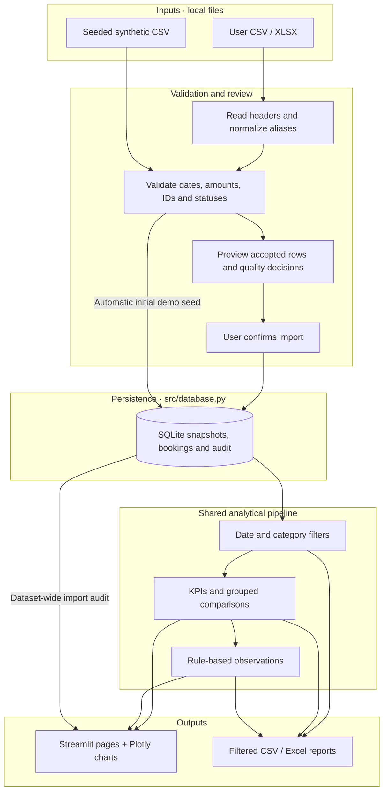

# StayScope · Booking Intelligence

A Python business intelligence application that turns hotel booking files into validated, filterable insights about booking value, cancellations, channels and supplier markup.

**Portfolio release candidate · Local application · Synthetic demonstration data**

## The problem

Hotel managers need to reconcile booking totals, understand cancellation patterns and compare sales channels without confusing selling value with revenue or profit. Spreadsheet exports often contain inconsistent columns, missing values and duplicates. StayScope makes those quality decisions visible before analysis and uses the same filtered records for charts, KPIs and downloadable reports.

## What it demonstrates

- **Data engineering:** CSV/XLSX ingestion, explicit validation, row-level quarantine and repeat-import protection.
- **Business analysis:** documented KPI formulas, cancellation denominators, sample-size cautions and transparent rule-based observations.
- **Application development:** four Streamlit pages, interactive Plotly charts and shared date/property/channel/room/status/rating filters.
- **Persistence and reliability:** transactional SQLite snapshots, guarded demo reset, modular Python and automated UI/data tests.
- **Reporting:** filtered booking CSV, KPI/finding CSV and two-sheet Excel reports with filter context.

## Product tour

| Page | Manager's question | Working features |
|---|---|---|
| Overview | How is the booking portfolio performing? | Eight KPI cards, value trends, channel/room/rating/status charts, property tables and insights |
| Cancellation explorer | Which groups have different cancellation rates? | Channel, room, city and month comparisons with sample sizes; no causal claims |
| Dataset explorer | Can I trust and inspect these numbers? | Filtered records, missing counts, data types, statistics and original import audit |
| Import & quality | What will happen to my uploaded records? | Quality preview, quarantined records, explicit approval, separate saved snapshots |

**Demo provenance:** the included CSV contains 1,800 fictional bookings for six Indian cities across 2025, generated with NumPy seed 42. Amounts are INR. The app visibly labels the demo; these are not real hotel results or claimed client outcomes.

## Technology stack

| Layer | Technology |
|---|---|
| Language | Python 3.12 verified; Python 3.11 within declared dependency requirements |
| Analysis | Pandas, NumPy |
| Interface | Streamlit |
| Visualization | Plotly |
| Persistence | SQLite via Python's standard library |
| Excel | openpyxl |
| Tests | Pytest, Streamlit AppTest |

No paid APIs, external accounts or application environment variables are required. No `.env.example` is needed.

## Architecture



The automatic seed path applies only to the bundled demo; uploaded data requires review. Each upload is a separate snapshot, so overlapping files are never silently combined. Parameterized SQL and transactions protect imports; demo restoration validates the replacement before an atomic delete/restore operation.

## Folder structure

```text
booking-analytics/
├── app.py                       # Streamlit entry point and four pages
├── src/
│   ├── __init__.py
│   ├── analytics.py             # Filters, KPIs, comparisons and insights
│   ├── charts.py                # Consistent Plotly presentation
│   ├── database.py              # SQLite persistence and safe reset
│   ├── exports.py               # CSV/XLSX reports and formula protection
│   ├── sample.py                # Reproducible synthetic generator
│   └── validation.py            # Schema, aliases and quality decisions
├── data/
│   └── sample_hotel_bookings.csv # Only data file intended for Git
├── scripts/
│   ├── audit_metrics.py         # Read-only Decimal reconciliation
│   ├── generate_sample.py       # Generates sample only if absent
│   └── init_db.py               # Idempotent setup
├── tests/                       # Unit, integration and AppTest checks
├── docs/
│   ├── DATA_GUIDE.md            # Schema, cleaning and metric assumptions
│   └── RELEASE_CHECKLIST.md     # Review, first commit and publishing steps
├── .streamlit/config.toml       # Public theme and upload settings
├── .gitignore
├── requirements.txt            # Bounded direct dependencies
├── requirements-tested.txt     # Verified direct versions, not a full lockfile
├── pytest.ini
├── README.md
├── AUDIT_REPORT.md
├── TEST_RESULTS.md
├── IMPLEMENTATION_PLAN.md
└── LICENSE
```

`data/bookings.db`, uploaded/private data, virtual environments and caches are local artifacts excluded from Git. No screenshot directory is claimed until genuine images have been captured.

## Install and run · Windows PowerShell

Open this project folder in VS Code. With Python installed:

```powershell
py -3 -m venv .venv
.\.venv\Scripts\python.exe -m pip install -r requirements.txt
.\.venv\Scripts\python.exe -m pip check
.\.venv\Scripts\python.exe scripts\init_db.py
.\.venv\Scripts\python.exe -m streamlit run app.py --server.address 127.0.0.1
```

Open `http://127.0.0.1:8501`. Stop with Ctrl+C. If `py` is unavailable but `python --version` works, use `python -m venv .venv`. Direct invocation avoids PowerShell activation-policy changes. The app can also seed the demo automatically when its database has no datasets.

In the already prepared Codex workspace only, replace `.\.venv\Scripts\python.exe` with `..\..\work\.venv\Scripts\python.exe`. That environment inherits bundled packages; the relative path is not portable to a clone. Python 3.12.14 and the installed dependency set have been verified. A clean-machine installation and other Python versions have not yet been certified.

## Use it

1. Start with the synthetic snapshot and explore Overview.
2. Select dates and categories in the sidebar; all analytical pages and reports use this selection. An empty multiselect means no matching records.
3. Open Cancellation explorer and compare rates alongside denominators.
4. Upload CSV/XLSX through Import & quality, review decisions, confirm the currency, and save. Select the saved snapshot in the sidebar.
5. Download the selected bookings or summary report. Table search, sort and Plotly zoom are presentation controls and do not redefine sidebar filters.

Required columns: `booking_id`, `booking_date`, `status`, `booking_value`. Dates must be ISO-formatted. Optional fields add city, property, channel, room type, rating and supplier cost. See the [data guide](docs/DATA_GUIDE.md) for aliases, validation rules and all formulas.

**Interpretation:** Total booking value includes every selected status. Retained booking value includes Confirmed + Completed. Retained markup subtracts supplier cost only when eligible costs are complete. These are not cash collected, recognized revenue or accounting profit. All five statuses reconcile to the total: 372 Confirmed + 998 Completed + 325 Cancelled + 62 Pending + 43 No-show = 1,800 in the bundled demo. Cancellation rate is 325 / 1,800 = 18.0556%, displayed as 18.1%.

## Tests and evidence

```powershell
.\.venv\Scripts\python.exe -m pytest -q -ra
.\.venv\Scripts\python.exe scripts\audit_metrics.py
```

The suite covers calculations, all sidebar filters, actual chart/export inputs, malformed uploads, duplicates, missing fields, audit persistence, transactional rollback, SQL parameters, navigation, synthetic notices and saved uploads across fresh application processes. Tests use disposable databases rather than deleting live data. The audit script opens the local database read-only and reconciles KPIs using Decimal calculations.

See [test results](TEST_RESULTS.md) for the latest measured counts and [audit report](AUDIT_REPORT.md) for the review findings. No CI badge or deployed-demo link is shown because neither has been published.

## Capture genuine screenshots

Use the bundled synthetic snapshot and a consistent laptop-sized browser window. Capture the actual app with your OS screenshot tool; do not fabricate values or substitute mockups. Keep the synthetic notice and relevant filters visible. Save reviewed images under `docs/screenshots/`:

| Image | Capture procedure |
|---|---|
| `overview.png` | Select Overview, all statuses and the full date range; show KPI cards and a booking-value chart |
| `cancellations.png` | Select Cancellation explorer; show comparison dimension, rates and sample sizes |
| `dataset.png` | Select Dataset explorer; show demo records and column/missing-value information without private uploads |
| `quality.png` | On Import & quality, preview a disposable copy of the synthetic CSV with one duplicate and one invalid date; show quality counts and decisions without saving it |

If the viewport cannot show everything, capture two genuine views and label them. Do not crop away provenance or alter displayed numbers. Only add Markdown image links after the files exist. Review each image for private filenames, personal information and credentials before staging it. The quality-page sample download is synthetic; label the screenshot accordingly because this page does not show business KPIs.

## Privacy, security and limitations

- Local single-user app without authentication or production hardening. Bind to loopback as shown above and do not expose sensitive data publicly.
- Unknown columns are excluded from storage, but recognized fields and filenames can still contain sensitive text. SQLite files are not encrypted. Keep originals, database backups and private exports outside the repository.
- CSV/XLSX text exports neutralize formula prefixes; forbidden Excel controls are escaped. Static application CSS is the only `unsafe_allow_html` use. Upload values are not interpolated into SQL commands.
- Upload limits are 20 MB / 100,000 rows. These are input limits, not load-test guarantees; compressed XLSX expansion and unusually long text can still consume resources. Only process trusted local files.
- Monetary calculations use floats/SQLite REAL, not ledger-grade fixed-point accounting. No occupancy, payment, refund, commission or overhead fields are invented.
- Dates are booking dates; timestamps normalize to UTC day. Raw invalid input values are not persisted. Excel's cell-length limit applies; use CSV for long text.
- Filters are session-local and may reset after visiting Import. Excel reports are generated eagerly on reruns. Cross-browser, accessibility, fresh-machine installation and abrupt-crash recovery are not certified.
- Git exclusions prevent ordinary accidental additions, not deliberate `git add -f` or leakage through arbitrary text/screenshots. Always review the staged diff before publishing.

No application environment variables are used, so no `.env.example` is included. The existing MIT license is preserved. See the [release checklist](docs/RELEASE_CHECKLIST.md) before your first commit.

## Troubleshooting

| Symptom | Action |
|---|---|
| Missing Python/module | Install Python, then requirements using the same interpreter that launches the app |
| Port 8501 occupied | Keep the running server; add `--server.port 8502` for a separate session |
| No matching rows | Check dates and every multiselect; clearing one selects zero rows |
| Status cards do not total correctly | Include Completed, Pending and No-show; use the status-distribution chart |
| Markup is N/A | Supply costs for every selected Confirmed/Completed booking |
| Invalid date | Use ISO `YYYY-MM-DD`; ambiguous day/month strings are rejected |
| Saved upload appears missing | Select its snapshot; confirm the project still has its original `data/bookings.db` |
| Database error | Check folder permissions and processes holding a SQLite lock; do not delete the DB |
| Code-change banner | Use Rerun; demo reset is not a refresh mechanism |

## License

[MIT](LICENSE). The bundled dataset is generated demonstration data, not private hotel records.
