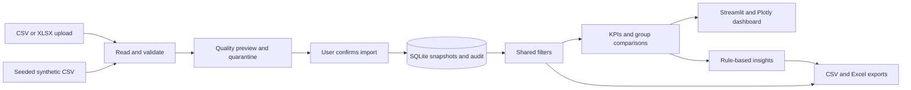

# Data and metric reference

## Data contract

One row represents one booking, not one room-night or a payment. Required columns:

| Column | Rule |
|---|---|
| `booking_id` | Nonempty identifier unique within a dataset |
| `booking_date` | ISO date `YYYY-MM-DD`; ISO timestamps accepted and normalized to UTC day |
| `status` | Confirmed, Cancelled, Completed, Pending or No-show |
| `booking_value` | Finite nonnegative selling value for the entire booking |

Optional: `city`, `property`, `channel`, `room_type`, `star_rating` (integer 1–5), `cost` (finite nonnegative supplier cost for the whole booking).

Headers are case-insensitive; spaces and punctuation become underscores. Examples of accepted aliases:

| Input | Canonical column |
|---|---|
| Reservation ID | booking_id |
| Reservation Date / Date of Booking | booking_date |
| Booking Status | status |
| Selling Price / Total Amount / Booking Amount | booking_value |
| Booking Channel | channel |
| Hotel Name / Property Name | property |
| Hotel City | city |
| Room Category | room_type |
| Hotel Rating / Stars | star_rating |
| Purchase Cost / Supplier Cost | cost |

`canceled` maps to Cancelled, `booked` to Confirmed, and `checked out` to Completed. Unknown statuses are quarantined. Ambiguous duplicate headers are rejected. Category spellings are otherwise preserved; `OTA` and `Online travel agency` are separate values unless you standardize them upstream.

CSV uses UTF-8, comma separators and plain decimal monetary values without currency symbols or thousands separators. XLSX reads the first worksheet. The app asks you to confirm a single currency per dataset; it does not infer currency or perform conversion. Limits: 20 MB and 100,000 rows per file.

Duplicate headers (including aliases) and CSV records with the wrong number of fields are rejected before analysis. Blank CSV records are retained for quarantine. Literal identifiers such as `NA` and `001` remain text; only empty identifiers are treated as missing. Monetary strings such as `NA` remain invalid numeric values. File or currency changes require a fresh review checkbox confirmation.

### Cleaning and privacy decisions

1. Missing identifiers, invalid dates, unsupported statuses, negative/missing/infinite booking values quarantine the entire row.
2. Missing category fields become `Unknown`. Invalid or missing optional numbers stay missing; no costs are imputed as zero.
3. Exact canonical duplicates retain the first row. If an identifier has conflicting canonical records, all versions are quarantined.
4. Row issues include `source_row`, field, reason and action. For Excel, this is the worksheet row (header is row 1). For CSV, it is the logical record number including blank records; a quoted multiline field counts as one record, so it need not equal a text editor's physical line number. Dataset-level ignored columns and absent optional columns are also reported.
5. Unknown columns such as guest names, emails and phone numbers are excluded from storage and exports. Recognized text columns are not automatically anonymized: do not put personal information in them.
6. The database persists accepted records, normalized quarantined records and quality decisions. It does **not** retain raw uploads or raw invalid values; keep your original file to repair rejected rows. Nothing is silently removed from the source file.
7. Spreadsheet exports neutralize text beginning with formula prefixes. Excel-incompatible control characters are shown as visible escapes such as `\x01` instead of crashing export. Source values in the database are unchanged.

## Metric definitions

| Metric | Definition |
|---|---|
| Total bookings | Accepted filtered row count |
| Confirmed bookings | Status exactly Confirmed; excludes Completed |
| Cancelled bookings | Status exactly Cancelled |
| Cancellation rate | Cancelled / all filtered bookings; N/A for zero rows |
| Total booking value | Sum of all booking values, including cancelled and pending bookings |
| Retained booking value | Value of Confirmed + Completed bookings |
| Average booking value | Total booking value / total bookings; N/A when empty |
| Retained markup | Sum(value − supplier cost) for Confirmed + Completed; N/A unless every eligible row has cost |

**Booking value is not recognized revenue or cash collected.** Retained value is an operational proxy, not net revenue after refunds/commissions. Pending and No-show rows do not enter retained value. No cash, refund, commission, tax, overhead, inventory or stay-date data exists in the V1 contract. Therefore the app does not invent net revenue, accounting profit, occupancy, ADR or RevPAR. Negative markup is valid when supplier cost exceeds selling value.

The date filter and trend use **booking date**, not arrival/stay date. Status filters affect rate denominators; selecting only Cancelled correctly gives 100%. The cancellation page warns when only one status remains.

### Reconciling the status cards

Confirmed and Cancelled are two of five mutually exclusive statuses; their cards alone do not add up to Total bookings. Use the booking-status chart for the complete distribution. The bundled snapshot reconciles as follows:

| Status | Bookings |
|---|---:|
| Confirmed | 372 |
| Completed | 998 |
| Cancelled | 325 |
| Pending | 62 |
| No-show | 43 |
| **Total** | **1,800** |

The unfiltered cancellation rate is `325 / 1800 = 18.0556%`, displayed as **18.1%**. It is not `Cancelled / (Confirmed + Cancelled)`. These are synthetic sample counts, not real hotel results; filtered counts and denominators are recalculated from the selected rows.

### Insight rules

- Require at least 20 filtered bookings for comparative observations.
- Flag channels with at least 20 bookings and cancellation rate at least five percentage points above the filtered overall rate.
- Report the room type with the largest share of total booking value; ties are explicit, and zero total value produces no share claim.
- No significance or causality is asserted. Sample thresholds do not establish statistical significance. Month charts may contain partial months when filters clip a period; no automatic growth claim is made.

## Persistence and architecture

Each import creates an independent snapshot. The dashboard selects one snapshot at a time; it never appends overlapping uploads to the same aggregate. A SHA-256 fingerprint over sorted canonical accepted rows, currency, demo flag and quality summary prevents repeated equivalent imports, including reordered clean rows. Detailed quality decisions and quarantined rows are also compared: changed audit evidence creates a separate snapshot even if the counts and accepted rows match. Reordering rows with quality issues can create a new snapshot because source-row references change. Existing fingerprints remain compatible. Snapshots are never combined automatically. Booking IDs are unique within each snapshot.

SQLite writes are parameterized and transactional. A write transaction serializes duplicate lookup and insertion. Foreign keys cascade demo deletion to its bookings. The UI validates the replacement sample first, then deletes/restores the demo within a single transaction; an insertion failure rolls back the deletion. Initialization is idempotent. The DB is local at `data/bookings.db` and excluded from Git. There is no automatic deletion of uploaded datasets. For a backup, stop the app and copy the DB to a private location.



```text
app.py                     Streamlit layout and page interactions
src/validation.py          Schema, aliases and audited cleaning
src/database.py            SQLite schema and snapshot persistence
src/analytics.py           KPIs, filters, comparisons and insights
src/exports.py             Safe CSV and Excel reports
src/charts.py              Plotly presentation defaults
src/sample.py              Seeded synthetic data generator
scripts/init_db.py         Idempotent database setup
scripts/generate_sample.py Generate sample only if absent
scripts/audit_metrics.py   Read-only independent Decimal reconciliation
data/sample_hotel_bookings.csv
tests/                     Deterministic unit and UI interaction tests
.streamlit/config.toml     Theme, upload limit and telemetry setting
```

No environment variables or `.env` are required. This is a local single-user portfolio app, without authentication or production hosting. Do not expose it publicly with sensitive business data.

